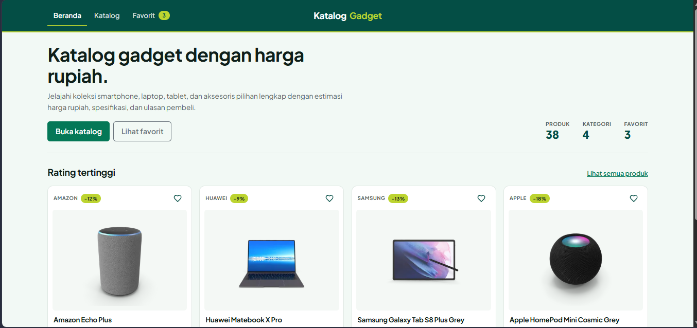
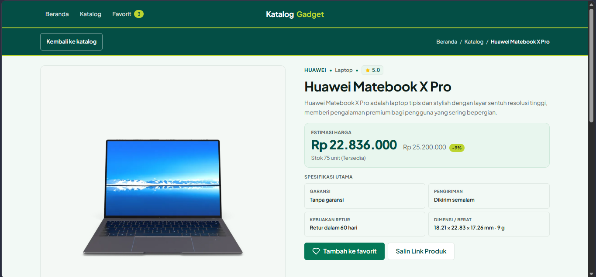
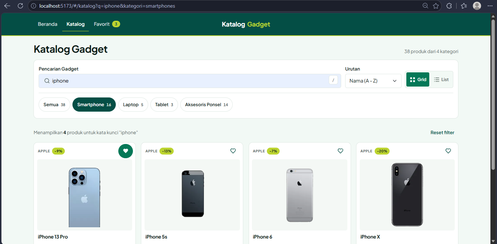

# Katalog Gadget

- Nama: Adi Karunia
- NIM: 1247050127
- Kelas: A
- Mata kuliah: Pengembangan Aplikasi Web, Pertemuan 8
- Website: https://adikarunia.my.id/pertemuan8/
- Repository: https://github.com/Adi78137/tugas_paw/tree/main/tugas_pertemuan8

Katalog gadget ini menampilkan produk DummyJSON dalam bahasa Indonesia. Pengguna bisa mencari dan menyaring produk, membuka detail, menyimpan favorit, dan menulis catatan pribadi per produk. Harga ditampilkan sebagai estimasi rupiah, bukan harga resmi toko.

## Teknologi

- React 19 dan TypeScript 7
- React Router 7
- Vite 8
- Bootstrap 5
- Oxlint

## Fitur

- Beranda menampilkan ringkasan jumlah produk, jumlah kategori, jumlah favorit, dan empat produk dengan rating tertinggi.
- Katalog menyediakan pencarian, filter kategori, urutan nama, harga, dan rating, serta tampilan grid atau list.
- Katalog membagi hasil delapan produk per halaman. Tekan `/` untuk memfokuskan kolom pencarian.
- Halaman detail menampilkan gambar utama, pilihan thumbnail, spesifikasi, stok, ulasan pembeli, estimasi harga, tombol favorit, dan tombol salin tautan.
- Catatan pribadi tersimpan per produk di localStorage dan bisa ditambah atau dihapus.
- Daftar favorit memakai Context API, tersimpan di localStorage, dan bisa dikosongkan setelah konfirmasi.
- Setiap halaman data memiliki kondisi memuat, error dengan tombol coba lagi, dan keadaan kosong.

## Routing

`HashRouter` di `src/main.tsx` membungkus seluruh aplikasi. `App` memasang `FavoritesProvider` dan satu rute induk `Layout`. Rute induk memakai `Outlet`, sehingga navbar dan footer tetap muncul di semua halaman.

| Rute | Halaman | Isi |
| --- | --- | --- |
| `/` | `HomePage` | Ringkasan katalog dan produk rating tertinggi |
| `/katalog` | `CatalogPage` | Pencarian, filter, urutan, tampilan, dan pagination |
| `/produk/:id` | `ProductDetailPage` | Detail satu produk berdasarkan parameter `id` |
| `/favorit` | `FavoritesPage` | Produk yang disimpan pengguna |
| `*` | `NotFoundPage` | Halaman saat rute tidak dikenal |

`CatalogPage` memakai `useSearchParams` untuk menyimpan kata kunci, kategori, urutan, dan halaman di URL. `ProductCard` meneruskan `location.search` sebagai state saat pengguna membuka detail, sehingga tombol kembali membawa pengguna ke hasil pencarian sebelumnya. `HashRouter` dan `base: './'` membuat aplikasi tetap bisa dibuka dari folder statis GitHub Pages tanpa rewrite server.

## State management

Favorit merupakan data global. `FavoritesProvider` menyimpan `favoriteIds` lewat `useLocalStorage` dengan kunci `gadget_favorites`. Komponen yang butuh data itu memanggil `useFavorites()` untuk memakai `isFavorite`, `toggleFavorite`, dan `clearFavorites`.

State lokal tetap berada di komponen yang memakainya. `CatalogPage` menyimpan nilai input cari dan pilihan tampilan grid atau list. `ProductDetailPage` menyimpan indeks gambar aktif dan pesan salin tautan. `FavoritesPage` menyimpan status konfirmasi hapus semua.

Filter katalog tidak disimpan sebagai state biasa. `useSearchParams` menyimpan `q`, `kategori`, `urut`, dan `hal` di URL. `useDebounce` menunda pembaruan `q` selama 300 ms agar permintaan pencarian tidak berubah pada setiap ketikan.

## API

`src/services/api.ts` memakai `fetch` dengan `AbortController`. Alamat dasar berasal dari `VITE_API_BASE_URL` dan memakai `https://dummyjson.com` jika variabel itu tidak tersedia.

`getAllGadgets()` mengambil produk dari empat kategori, yaitu smartphones, laptops, tablets, dan mobile-accessories, lalu menggabungkan hasilnya. `getProductById(id)` mengambil satu produk. `useFetch` mengelola `data`, `loading`, `error`, dan `refetch` untuk kedua pemanggilan tersebut.

`formatHarga()` memanggil `hitungHarga()` lebih dulu untuk menerapkan diskon. Fungsi itu lalu mengalikan nilai USD dengan kurs estimasi `18000` dan membulatkannya ke ribuan terdekat. Kurs ini tetap dan bukan harga resmi ritel.

## Custom hooks

| Hook | Fungsi |
| --- | --- |
| `useFetch` | Mengambil data async, mengelola loading dan error, serta menyediakan `refetch` |
| `useGadgets` | Memanggil `getAllGadgets()` lewat `useFetch` |
| `useGadget` | Memanggil `getProductById(id)` dan mengikuti perubahan parameter `id` |
| `useFavorites` | Mengambil konteks favorit dan menolak pemakaian di luar provider |
| `useLocalStorage` | Membaca dan menulis nilai localStorage serta menyinkronkan perubahan antar tab |
| `useNotes` | Menambah dan menghapus catatan dengan kunci penyimpanan per produk |
| `useDebounce` | Menunda pembaruan nilai selama jeda tertentu |
| `useDocumentTitle` | Mengganti judul dokumen per halaman dan mengembalikan judul sebelumnya |

## Struktur folder

```
tugas_pertemuan8/
├── public/
│   ├── favicon.svg
│   └── icons.svg
├── src/
│   ├── components/
│   │   ├── Catalog.css
│   │   ├── CategoryChips.tsx
│   │   ├── EmptyState.tsx
│   │   ├── ErrorMessage.tsx
│   │   ├── Icons.tsx
│   │   ├── Layout.tsx
│   │   ├── LoadingSpinner.tsx
│   │   ├── NoteForm.tsx
│   │   ├── NoteList.tsx
│   │   ├── Pagination.tsx
│   │   ├── ProductCard.tsx
│   │   ├── RatingBadge.tsx
│   │   ├── SearchInput.tsx
│   │   ├── SelectFilter.tsx
│   │   └── ViewToggle.tsx
│   ├── context/
│   │   ├── FavoritesContext.tsx
│   │   └── favoritesContextDef.ts
│   ├── hooks/
│   │   ├── useDebounce.ts
│   │   ├── useDocumentTitle.ts
│   │   ├── useFetch.ts
│   │   ├── useFavorites.ts
│   │   ├── useGadget.ts
│   │   ├── useGadgets.ts
│   │   ├── useLocalStorage.ts
│   │   └── useNotes.ts
│   ├── pages/
│   │   ├── CatalogPage.tsx
│   │   ├── FavoritesPage.tsx
│   │   ├── HomePage.tsx
│   │   ├── NotFoundPage.tsx
│   │   └── ProductDetailPage.tsx
│   ├── services/
│   │   ├── api.ts
│   │   └── productService.ts
│   ├── types/
│   │   └── product.ts
│   ├── utils/
│   │   ├── constants.ts
│   │   ├── descriptions.ts
│   │   ├── format.ts
│   │   ├── localize.ts
│   │   └── productQuery.ts
│   ├── App.tsx
│   ├── App.css
│   ├── index.css
│   ├── main.tsx
│   └── vite-env.d.ts
├── index.html
└── vite.config.ts
```

`App.tsx` merangkai rute dan provider. `Layout.tsx` menyimpan navbar dan footer. `pages/` berisi halaman, `components/` berisi bagian antarmuka yang dipakai ulang, `context/` berisi favorit global, `hooks/` berisi logika React yang dipakai ulang, `services/` berisi pemanggil API, dan `utils/` berisi fungsi bantu murni.

## Screenshot

File PNG belum ada di repository ini. Siapkan tiga berkas berikut di folder `docs/screenshots/` setelah website berjalan:

- `home.png`, beranda dengan ringkasan katalog dan produk rating tertinggi.
- `detail.png`, halaman detail dengan spesifikasi, ulasan, dan aksi produk.
- `interaktif.png`, halaman katalog saat pencarian, filter, favorit, atau pagination dipakai.

README ini belum menyisipkan tag gambar agar tidak menampilkan gambar rusak. Setelah PNG tersedia, tambahkan tiga baris ini di bawah daftar tersebut:

```markdown
### Tampilan Aplikasi

**Beranda**


**Detail Produk**


**Fitur Interaktif**

```

## Menjalankan

```bash
npm install
npm run dev
```

Perintah lain:

```bash
npm run lint
npm run build
```

Hasil build masuk ke folder `../pertemuan8/` sesuai konfigurasi `vite.config.ts`. Untuk mengubah sumber API, tambahkan `VITE_API_BASE_URL` di file `.env` sebelum menjalankan build.
